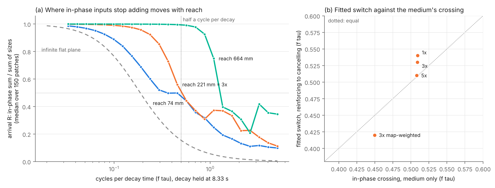

# Phase A findings

Results of the decision experiments in [plan.md](plan.md), recorded as they come in.
Every number here was computed in this rerun, on the code at the commit that adds it.

---

## A2 and the medium-only part of A3: where in-phase inputs stop adding

**Question.** The fitted drives switch from reinforcing to cancelling at about half a
cycle per decay time in all four wave-analysis media (docs/waves-findings.md: 0.54, 0.53,
0.51, 0.42). Is that switch a property of the medium alone, as the "phase advances by π
over one attenuation length at fτ = ½" argument says? Or does it depend on how the medium's
reach compares with the size of the sheet?

**Test.** No fitted drive is used. Every one of the 100 input pieces is driven at unit
amplitude and in phase. At each of 150 whole-cortex patches,
R = |Σ_k h_k| / Σ_k |h_k|. R is 1 when all contributions arrive in phase, and falls as
their propagation phases spread. The media are:

- the four recorded media;
- three flat stand-ins with the decay held at 8.33 s and only the speed changed, so that
  reach changes and fτ does not;
- an infinite flat plane, computed analytically (`phase_reach.plane_R`). It has no scale
  except the decay, so its curve depends on fτ alone.

`analysis/phase_reach.py`, about 2 hours single-threaded.



### Results

**1. The stand-ins are a valid tool.** The stand-in built at 8.33 s and a spread label
of 4.5 reproduces the recorded 3x medium to every printed digit.

**2. The spread label is not the wave speed.** On the sheet the model runs on, waves travel
at 5.9× the spread label. The label is an older time-to-peak spread measured on the white
surface (`core/timescale.py`, `core/units.py`). The true speed is read off the
high-frequency phase speed:

| medium | label | wave speed | reach (speed × decay) |
|---|---|---|---|
| 1x | 1.5 mm/s | 8.8 mm/s | 220 mm |
| 3x | 4.5 mm/s | 26.5 mm/s | 221 mm |
| 5x | 7.5 mm/s | 44 mm/s | 222 mm |

For scale: the geodesic distances between the 150 patch centres have a median of 119 mm and
a maximum of 257 mm. So all four recorded media carry a response about as far as the
sheet is wide. Any "reach" quoted from the labels (e.g. 4.5 × 8.33 = 37.5 mm) understates
it about sixfold.

**3. The crossing moves with reach.** The fτ at which median R falls through 0.5,
interpolated:

| medium | reach | crossing (cycles per decay) |
|---|---|---|
| infinite flat plane | none (no sheet) | 0.19 |
| stand-in, 8.33 s | 74 mm | 0.36 (R hovers at 0.50–0.52 from 0.29 to 0.46) |
| 1x, 3x, 5x | ~220 mm | 0.51, 0.51, 0.51 |
| 3x map-weighted | ~220 mm (median) | 0.45 |
| stand-in, 8.33 s | 664 mm | 1.27 |

With the decay fixed, tripling the reach moves the crossing from 0.51 to 1.27 cycles per
decay. A third of the reach moves it down to 0.36. The analytic plane, the limit of a
sheet much larger than the reach, sits at 0.19.

So the frequency at which in-phase inputs stop adding is **not set by the medium alone**.
It depends on reach relative to the sheet:

- When the reach is short, the decay limits it, and it tends towards the plane's 0.19.
- When the reach is long, the sheet limits it: the spread of travel distances among the
  inputs is capped by the sheet, so it takes a higher frequency to spread their phases.

The recorded media sit where these two limits meet. That is why they line up at half a
cycle per decay.

**4. The fitted switch follows the medium's crossing.** Per medium:

| medium | in-phase crossing (medium only) | fitted switch (waves-findings) |
|---|---|---|
| 1x | 0.51 | 0.54 |
| 3x | 0.51 | 0.53 |
| 5x | 0.51 | 0.51 |
| 3x map-weighted | 0.45 | 0.42 |

The fitted switch comes out within 0.03 of the in-phase crossing, and the map-weighted medium is lowest
on both. That 0.03 is below the resolution of the fitted switch, which is read from bins
a factor of about 1.45 apart (see Rebuilds below). Only two distinct values of the medium-only crossing are in play, so this is
agreement, not a correlation. The fitted values are from the impulse-fixed solves; they will
be replaced by the rebuilt solves' values when the queue reaches them.

**5. The derivation in waves-findings is withdrawn as the explanation.** "Phase π across
one attenuation length at fτ = ½" gives the right number only because reach ≈ sheet in
those media. On the plane the same in-phase sum stops adding at 0.19, near
1/(2π) ≈ 0.16, where the uniform response |1/(1/τ − iω)|² rolls off. The medium law itself
holds where it can be tested. Write k for the complex wavenumber, ω = 2πf for the angular
frequency and c for the wave speed:

- **The law, k = (ω + i/τ)/c.** For the 74 mm stand-in at high fτ, the mesh matches the
  flat-plane Green's function. At fτ = 5 the phase/amplitude slope ratio is 31.7 against
  2πfτ = 31.4, and the attenuation length is 74 mm against cτ = 73 mm.
- **Where the check cannot be made.** The dispersion check is uninformative for the
  ~220 mm-reach media. Its 15–60 mm annuli lie in the near field, where even the
  flat-plane Green's function does not give the far-field ratio.

**6. Two smaller observations.**

- **Timing patterns.** Count the distinct timing patterns the patches ask for, relative to
  the count without the phases. At half a cycle per decay it is about 2.7× in the recorded
  media and about 3× at a 74 mm reach. At a 664 mm reach it stays near 1 up to about 0.7
  cycles per decay.
- **Resonance.** Around fτ ≈ 0.4–0.45 the ~220 mm media's amplitude barely falls with
  distance (the L column in the log). This is where the sheet's lowest modes sit: the
  wavelength there is about 480 mm, roughly twice the largest patch distance. In these media, that resonance and the crossing
  land at about the same frequency.

### What this changes

- **Framing point 3**, that medium, geometry and input cannot be separated from FC alone,
  now has a fit-free, quantitative instance. The frequency below which inputs must be
  timed to reinforce, and above which the waves are what is left after cancellation, is
  set by the medium and the sheet together. The input timing then supplies the contrast
  either side of it (the controls in waves-findings).
- **The BOLD-band conclusions.** In waves-findings, BOLD sees mostly reinforcing waves in
  3x and 5x and mostly cancelling ones in 1x. Whether that is so depends on where the
  crossing falls relative to the BOLD band, so it depends on reach relative to sheet, not
  on the decay alone. A 664 mm reach at 8.33 s puts the in-phase crossing at 0.15 Hz,
  above the whole 0.01–0.08 Hz band.
- **Toy examples.** "Phased array on a finite sheet" is the right toy: the same timing
  rule reinforces or cancels depending on f, on the decay and on the travel time across
  the sheet.

### Test queued after A2 (results under "A3 on fitted drives" below)

Two solves at decay 8.33 s with reach 74 mm and 664 mm (`nobp_sm6_reach033_box`,
`nobp_sm6_reach3_box`), with `interplay.py bold` and its controls on each, and
`interplay.py media` across them and the rebuilt 3x. **Prediction:** the fitted switch
moves with the in-phase crossing, to about 0.36 cycles per decay (0.043 Hz) and about 1.27
(0.15 Hz). If instead it stays near 0.5, the switch belongs to something in the fit rather
than to the medium on this sheet.

### A3 on fitted drives

Three solves at the same decay (8.33 s), differing only in reach: `nobp_sm6_reach033_box`
(spread label 1.5), the rebuilt 3x `nobp_sm6_s3_box` (4.5) and `nobp_sm6_reach3_box` (13.5).
Each has `interplay.py bold` under the fitted drive and its six controls.


The curve in each panel is the share of the 150 patches reinforcing minus the share
cancelling, under the fitted drive. Above zero, more patches build their waves by
reinforcing; below, by cancelling. Grey is the range over the six controls (random coherent
drive and timing-only control, three seeds each). The dotted line is the medium-only
in-phase crossing from A2. The beige band is 0.01–0.08 Hz.

| | 74 mm | 221 mm (3x, rebuilt) | 664 mm |
|---|---|---|---|
| in-phase crossing (A2, medium only) | 0.36 | 0.51 | 1.27 |
| fitted switch | **none** | 0.53 | **1.29** (0.155 Hz) |
| fit (2,000 solve vertices) | 0.7777 | 0.8087 | 0.6360 |
| realised, 4 draws | +0.7080 ± 0.0064 | +0.7568 ± 0.0014 | +0.6027 ± 0.0026 |
| spatial-autocorrelation mismatch (`gap` in the logs: mean absolute difference in Moran's I, model against data) | 0.057 | 0.070 | 0.103 |
| rank | 28.7 | 18.6 | 2.2 |
| still gaining at 150 evaluations (last 15) | 0.0006 | 0.0011 | 0.0070 |
| reinforcing / cancelling, HRF + 0.01–0.08 Hz | 5% / 58% | 53% / 29% | 66% / 15% |

**Long reach: the prediction held.** The fitted drive reinforces at 46–91% of patches from
0.13 to 1.02 cycles per decay and cancels at 59–99% from 1.46 up. The switch between them,
interpolated, is at 1.29 cycles per decay against a predicted 1.27. The bins there are a
factor of 1.43 apart, so this says the switch lies between 1.02 and 1.46, which contains
the prediction, and is far from the 0.5 of the recorded media.

One qualification about how the switch is read. `interplay.py media` reports the *first*
bin where cancelling overtakes reinforcing. In the 664 mm solve that is a flicker at 0.08
cycles per decay (27% reinforcing against 35% cancelling, with 27% single source), after
which reinforcing leads again until 1.29. I added a second readout, the crossing above
which cancelling leads in every bin, after seeing this solve. For the 3x solve the two
readouts agree (0.53). The figure uses the second.

**Short reach: the prediction failed** (left panel). There is
no reinforcing regime: cancelling leads in every bin, at 57–87% of patches. In-phase
inputs could still add below 0.36 cycles per decay (in-phase R 0.99 at 0.04), but the
fitted drive does not use that.

**The controls.** Comparing the fitted curve with the range of the six controls, bin by bin:

- **Above its switch**, the fit cancels more than any control in every bin, in both the
  221 mm (6 of 6 bins) and 664 mm (4 of 4) media.
- **Below its switch**, the fit reinforces more than any control in 5 of 8 bins (221 mm)
  and 4 of 10 (664 mm). In the rest, which include the lowest bins in both media, it lies
  inside the range.
- **In the 74 mm medium** it cancels more than any control in 13 of the 14 bins.

The controls carry a lean of their own, set by the medium. In the 664 mm medium their
mean is +0.27 to +0.56 (towards reinforcing) from 0.13 to 1.02 cycles per decay, and two
of the three timing-only seeds never cross over. In the 74 mm medium their mean is −0.14
to −0.33 at every frequency. In the 221 mm medium it stays between −0.21 and +0.10. So the
medium sets a lean, and the fit works with it or against it:

- At 74 mm the fit goes further in the medium's direction (cancelling) at every frequency.
- At 664 mm it goes further in the medium's direction (reinforcing) below the switch, and
  reverses it above.
- At 221 mm the controls barely lean, so both regimes come from the fit.

**What A3 says.** Taking both reaches together:

- The in-phase crossing behaves as an **upper limit** on where reinforcing can lead. In
  none of the three media does reinforcing lead above it.
- Whether reinforcing leads **below** it is not fixed by the crossing. In two of the three
  media the fit uses reinforcing all the way up to the crossing. In the 74 mm medium it
  never does.
- So the switch the waves analysis found at half a cycle per decay is the medium-and-sheet
  limit, reached by a fit that chooses to reinforce. Both parts are needed: the limit from
  the medium and sheet, the choice from what the FC asks of that medium.

**The 664 mm fit is not converged.** At 150 evaluations it was still gaining about 0.007
per 15 evaluations, six times the 3x rate. Its effective rank of 2.2 and its realised score
are therefore from a fit stopped early, and the fit scores in the table are not a
like-for-like comparison of the three media. The 150-evaluation budget is the project
convention and stands in for a realisability penalty (see `--prank-mu` in
`fit/best_fit.py`), but that brake clearly binds harder in this medium. A 600-evaluation solve
(`nobp_sm6_reach3_f600_box`) is queued after the rebuilds to check whether the switch
stays at about 1.3 as the fit converges.

Logs: [build_reach033](logs/build_reach033.txt), [bold_reach033](logs/bold_reach033_box_fitted.txt),
[build_reach3](logs/build_reach3.txt), [bold_reach3](logs/bold_reach3_box_fitted.txt),
[media_reach](logs/media_reach.txt).

### Reproduce

```bash
python analysis/phase_reach.py --tags nobp_sm6_s1,nobp_sm6_s3,nobp_sm6_s5,nobp_sm6_mapsmm_s3 \
  --standin 8.3333,1.5 --standin 8.3333,4.5 --standin 8.3333,13.5
python analysis/phase_reach.py --figure results/phase_reach_<...>.npz    # the A2 figure
python analysis/phase_reach.py --fit-figure results/phase_reach_<...>.npz  # the A3 figure (needs the bold caches)
```

---

## A1: FC score under the controls

**Question.** The wave analysis shows the fitted drive's timing organising the waves. Does
the FC fit need that timing, or would the same input powers and coherence magnitudes fit
it as well?

**Test.** `fit/rescore.py` realises each control in place of the fitted cross-spectrum
and scores it exactly as the fit was scored: 4 draws of 577 s, 6 mm surface smoothing,
Spearman against the unfiltered RBC FC. The controls (`interplay.control_drive`):

- **independent**: each input keeps its power, all coherence is removed;
- **random**: the fitted eigenvalues with random eigenvectors, so coherent but never fitted;
- **timing**: every input's power and every coherence magnitude kept, a random phase per
  input per frequency;
- **delay jitter**: the fitted drive exactly, with each input shifted by its own random
  delay (normal, sd given; the same delays for every draw). Only the relative timing
  between inputs moves.

### Rebuilt 3x solve (`nobp_sm6_s3_box`)

| drive | realised FC, 4 draws | rank |
|---|---|---|
| fitted | +0.7568 ± 0.0014 | 18.6 |
| independent | +0.1369 ± 0.0143 | 36.3 |
| random, seeds 0/1/2 | +0.1106 / +0.1068 / +0.1138 | 32–35 |
| timing, seeds 0/1/2 | +0.1288 / +0.1117 / +0.1528 | 30–31 |

| delay jitter, sd (seed 0) | realised FC |
|---|---|
| 0 (fitted) | +0.7568 ± 0.0014 |
| 5 s, the **same** delay for every input (check) | +0.7577 ± 0.0014 (2 draws) |
| 0.1 s | +0.6141 ± 0.0027 (2 draws) |
| 0.3 s | +0.2619 ± 0.0145 (2 draws) |
| 0.5 s | +0.1341 ± 0.0135 (2 draws) |
| 1, 2, 5, 10, 20 s | +0.090, +0.106, +0.141, +0.072, +0.119 (4 draws each) |

**The check.** A delay common to every input is a pure time shift of the whole drive, so it
must leave the score unchanged, and it does (0.758 against 0.757). The drop under jitter
therefore comes from the relative timing between inputs alone.

**Result.** Every control drops the FC score from 0.757 to 0.11–0.15. Each input's power
and the medium together give about 0.11–0.15; everything above that comes from how the
inputs are timed relative to one another. Delay jitter shows how precisely: an sd of
0.1 s (most inputs moved by one 0.16 s frame or not at all) already costs 0.14, 0.3 s
costs about two thirds of the excess, and from 0.5 s up the score sits on the controls'
floor. The 1–20 s values scatter around that floor without trend (one seed each).

**What carries that timing.** A delay τ rotates the phase at frequency f by 2πfτ, so a
0.1–0.3 s jitter scrambles only the upper part of the band: the coherence that survives
is about exp(−4π²f²σ²), which halves at 0.13/σ Hz (1.3 Hz at σ = 0.1 s, 0.44 Hz at
σ = 0.3 s). So the fit leans on precisely held timing at a few tenths of a hertz and up to
the fMRI Nyquist of 0.775 Hz. That fits what `interplay.py bold` reports for this solve:
in the observable the fit is scored on, half of what each patch sees lies above 0.2 Hz
(median patch), and its waves there are mostly cancelling, with interference removing
117% of the net (logs/bold_s3_box_fitted.txt).

**Why this matters, and what it does not yet show.**

- **For framing point 2.** Under this observation model the answer to A1 is unambiguous:
  the FC fit needs the fitted relative timing, not just the powers and coherences.
- **The observation model.** The observable these solves are fitted and scored on is the
  field low-passed by a 1.29 s gaussian (`--bold-smooth`), which removes only what sampling
  at the TR cannot report. That is deliberate: how the field becomes BOLD is not known, and
  the canonical HRF is one hypothesis among several (Phase B lists the gaussian, the HRF,
  HRF plus passband and the envelope). An earlier version of this note called A4 "the
  decisive test" on the assumption that real BOLD carries little above 0.1 Hz; that
  assumption is withdrawn.
- **What the data say, with no haemodynamic model.** `fit/band_fc.py` (2026-10-09, on the
  October solves, before the impulse fix) compared model and data FC band by band. The
  data's FC is nearly the same in every band below 0.2 Hz (the bands agree at 0.87–0.98).
  The 3x solve carried its FC in its fast bands (0.08–0.2 Hz +0.46, 0.2–0.775 Hz +0.45)
  and matched the slow bands poorly (+0.16 to +0.27). The sub-second timing A1 finds is
  most likely that fast-band FC. The data-grounded check is therefore A1 on a solve made
  to match the data band by band (`--fit-bands`, which in October lifted the 3x slow bands
  to +0.31 to +0.61 at a cost of 0.04 overall). A fit through the canonical HRF (A4) is a
  check under one hypothesis, not a test against the truth.
- **Interpreting the wave analysis.** The categories read through the HRF (53%
  reinforcing in the BOLD band, 3x) are a reading of the same solve. They do not show
  that a fit through the HRF would choose the same timing.

The 0.1–0.5 s rows are 2-draw checks. A 4-draw grid at 0.1, 0.2, 0.3 and 0.5 s on all four
rebuilt solves is queued after the rebuilds.

Logs: [logs/a1_s3](logs/a1_s3/).

### Rebuilt 1x solve (`nobp_sm6_s1_box`, decay 25 s)

| drive | realised FC, 4 draws |
|---|---|
| fitted | +0.7232 ± 0.0099 |
| independent | +0.0980 ± 0.0222 |
| random, seeds 0/1/2 | +0.0762 / +0.0714 / +0.0812 |
| timing, seeds 0/1/2 | +0.0747 / +0.1108 / +0.1030 |

| delay jitter, sd (seed 0) | 0.1 s | 0.2 s | 0.3 s | 0.5 s | 1 s | 2 s | 5 s | 10 s | 20 s |
|---|---|---|---|---|---|---|---|---|---|
| realised FC | +0.699 | +0.625 | +0.557 | +0.376 | +0.180 | +0.110 | +0.087 | +0.089 | +0.067 |

The same picture as 3x, at a slower scale. Every control falls to 0.07–0.11. Timing still
matters below a second, but this medium tolerates more of it: 0.1 s costs 0.024 here
against 0.14 in 3x, and the score reaches the controls' floor at about 2 s rather than
0.5 s. In this medium the fitted observable has half its power below 0.11 Hz (median
patch), against 0.20 Hz in 3x (logs/bold_s1_box_fitted.txt).

Logs: [logs/a1_s1](logs/a1_s1/).

---

## A4: the 3x fit through the HRF (open: needs a decision on the observation model)

**Status (2026-11-26): paused.** The canonical HRF is a hypothesis about how the field
becomes BOLD, not its known filter (see A1, "the observation model"). This section records
what happens under that one hypothesis.

**Question.** A1 shows the fitted FC rests on input timing held to a tenth of a second.
Under the hypothesis that BOLD is the field seen through the canonical HRF, which passes
little above 0.1 Hz, does a fit need the same timing, and does it build its waves the
same way?

**Test.** `best_fit.py --hrf` (core/hrf.py): the SPM canonical HRF in the observation
model on both sides of the fit. Its gain multiplies H on the solved bins, and the
realised frames are convolved with the same kernel. Everything else is as
`nobp_sm6_s3_box`. Check on a 15-evaluation run: fit 0.480 on the solve vertices,
realised 0.446 over the cortex, the usual relation between the two
([logs/a4/smoke_15evals.txt](logs/a4/smoke_15evals.txt)).

| | HRF, 150 evaluations | HRF, 600 evaluations | no HRF (rebuilt 3x, 150) |
|---|---|---|---|
| fit (2,000 solve vertices) | 0.6593 | 0.7380 | 0.8087 |
| realised, 4 draws | +0.6106 ± 0.0051 | +0.6687 ± 0.0133 | +0.7568 ± 0.0014 |
| still gaining at the end, per 15 evaluations | 0.0076 | about 0.0013 (0.0052 over the last 60) | 0.0011 |
| controls (independent, random, timing) | not run | +0.267 to +0.298 | +0.107 to +0.153 |
| switch, reinforcing to cancelling | 0.32 cycles per decay (0.038 Hz) | 0.08 (0.010 Hz) | 0.53 (0.063 Hz) |

### The HRF fit becomes one global signal

Measured on each solve's saved realisation
([logs/a4/global_share.py](logs/a4/global_share.py), output in
[global_share.txt](logs/a4/global_share.txt)):

| | share of each vertex's variance in the global signal | mean correlation between vertices | participation ratio of the correlation matrix |
|---|---|---|---|
| target FC | | +0.031 | 96.2 |
| 1x | 8.5% | +0.075 | 33.0 |
| 3x | 14.5% | +0.136 | 19.1 |
| 74 mm reach | 12.5% | +0.075 | 22.9 |
| 664 mm reach | 68.8% | +0.679 | 2.1 |
| 3x through the HRF, 150 evaluations | 91.0% | +0.907 | 1.2 |
| 3x through the HRF, 600 evaluations | 96.9% | +0.968 | 1.1 |

Running the fit longer made this worse, not better: from 91% to 97% global while the score
rose from 0.611 to 0.669. In its own observable, half of what each patch sees lies below
0.005 Hz, a period longer than 200 s (logs/a4/bold_s3_hrf_f600_box_fitted.txt). So the
fit is a slow global fluctuation with a structured remainder of about 3% of the variance.

**Why it still scores 0.67.** The target was built from data denoised with XCP-D's 36P
regressors, which include the global signal, plus linear detrending
(`targets/rbc_nobp.py`). The score double-centres both FC matrices before ranking edges
(`targets/fc_score.py`, `double_centre`: "the linear analogue of GSR") and Spearman sees
only rank. So the global component is invisible to the score, and the fit is free to make
it as large as it likes. The comparison is formally consistent with how the target was
processed. Whether cortex could look like this before preprocessing is not something these
data can say: raw BOLD carries a large global component of debated origin, and the target
had it regressed out. What the result shows is narrower. In this medium, under this
observation hypothesis, the fit reaches the target mainly through a component the score
cannot see.

**Why it happens in this medium.** The canonical kernel passes little above 0.1 Hz. A2 showed that this
medium's response reaches about as far as the hemisphere is wide (221 mm), so at those
frequencies every input's response spreads over most of the sheet. The 664 mm reach,
without the HRF, already went 69% global. Without the HRF the fit built its structure at
higher frequencies, where responses are local enough to differ between regions.

### Timing, through the HRF

| delay jitter, sd (seed 0) | 0 | 0.1 s | 0.2 s | 0.3 s | 0.5 s | 1 s | 2 s | 5 s | 10 s | 20 s |
|---|---|---|---|---|---|---|---|---|---|---|
| HRF, 600 evaluations | +0.669 | +0.630 | +0.513 | +0.422 | +0.307 | +0.251 | +0.255 | +0.284 | +0.288 | +0.300 |
| HRF, 150 evaluations | +0.611 | +0.602 | | +0.569 | | +0.300 | | | | |

The 600-evaluation fit is still sensitive to a few tenths of a second, which the HRF's
passband alone does not explain: at 0.05 Hz a 0.3 s delay is a phase error of only
0.1 rad. The structured remainder is about 3% of the variance, so a phase error that
leaves even 1% of the global signal unmatched is a third of it. The sensitivity belongs
to the small-remainder solution, not to the haemodynamics.

### Where this leaves A4

A4 cannot be answered under this observation hypothesis as it stands. Through the HRF alone, the fit does
not choose different timing for the waves so much as stop making differentiated waves.
Three things need deciding (Phase B, "observation model" and "scoring"):

1. **Put the data's preprocessing into the model's observable.** Detrending and global
   signal removal are part of how the target was made. A linear stand-in for the global
   regression, removing the mean over vertices, is a spatial operator and could be folded
   into H the way the 6 mm smoothing is. That stops a global fluctuation from being free.
2. **Report the global share beside every score**, as above, so a fit like this is seen.
3. **A score that sees magnitude**, alongside double-centred Spearman.

A medium with a shorter reach might build differentiated structure through the HRF where
this one cannot: a 600-evaluation HRF fit on the 74 mm medium would test that.

Point 1 is written and tested but has not been run: `core/confounds.py` and
`best_fit.py --confounds` (detrend, then regression on the global signal over the target's
vertices and its derivative, on both sides of the fit), on branch `a4-gsr`. It is held
until the observation model is discussed.

Logs: [logs/a4](logs/a4/).

---

## Rebuilds of the wave-analysis solves

Each rebuild is held to its recorded values within draw scatter. Recorded values are from
docs/waves-findings.md, at 150 evaluations.

| solve | fit (2,000 solve vertices) | realised, 4 draws of 577 s | rank | recorded | verdict |
|---|---|---|---|---|---|
| `nobp_sm6_s3_box` (3x flat) | 0.8087 | +0.7568 ± 0.0014 | 18.6 | fit 0.809, realised 0.756 ± 0.002, rank 18.6 | reproduced |
| `nobp_sm6_s1_box` (1x flat) | 0.8178 | +0.7232 ± 0.0099 | 38.2 | realised 0.724 | reproduced |

Log: [logs/build_s3.txt](logs/build_s3.txt). The 3x build took 28 minutes in this container.

**Categories and switch, 3x rebuilt** (`interplay.py bold` and `media`). Shares are
single source / reinforcing / cancelling / other, %, over all patches:

| reading | rebuilt | recorded |
|---|---|---|
| raw field | 5 / 4 / 77 / 14 | 5 / 5 / 76 / 15 |
| this model's observable | 5 / 11 / 74 / 10 | 5 / 11 / 73 / 10 |
| HRF | 8 / 43 / 37 / 12 | 8 / 43 / 37 / 12 |
| HRF + 0.01–0.08 Hz | 7 / 53 / 29 / 11 | 7 / 53 / 29 / 11 |
| switch, reinforcing to cancelling | 0.063 Hz = 0.53 cycles per decay | 0.063 Hz = 0.53 |

The timing-only control's first crossovers come out at 0.13, 0.11 and 0.04 cycles per
decay for the three seeds, inside the recorded 0.03–0.85 range.

**Categories and switch, 1x rebuilt** ([logs/bold_s1_box_fitted.txt](logs/bold_s1_box_fitted.txt)):

| reading | rebuilt | recorded |
|---|---|---|
| raw field | 23 / 7 / 48 / 22 | 24 / 7 / 47 / 22 |
| this model's observable | 10 / 7 / 68 / 14 | 10 / 7 / 68 / 14 |
| HRF | 9 / 16 / 59 / 16 | 9 / 16 / 59 / 16 |
| HRF + 0.01–0.08 Hz | 10 / 17 / 55 / 17 | 10 / 17 / 55 / 18 |
| switch, reinforcing to cancelling | 0.021 Hz = 0.54 cycles per decay | 0.022 Hz = 0.54 |

**Resolution of the switch.** The switch is read from 14 log-spaced bins. Near it they
sit at 0.34, 0.49 and 0.71 cycles per decay, a factor of about 1.45 apart. So differences
of a few hundredths between a fitted switch and an in-phase crossing (A2, finding 4) are
below what the bins resolve. The A3 prediction is a shift of about a factor of 0.7 or
2.5, which they resolve easily.
