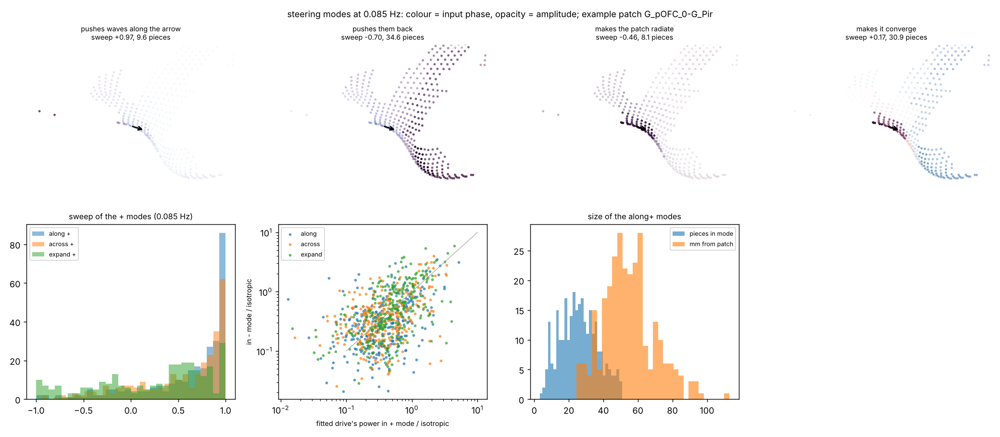
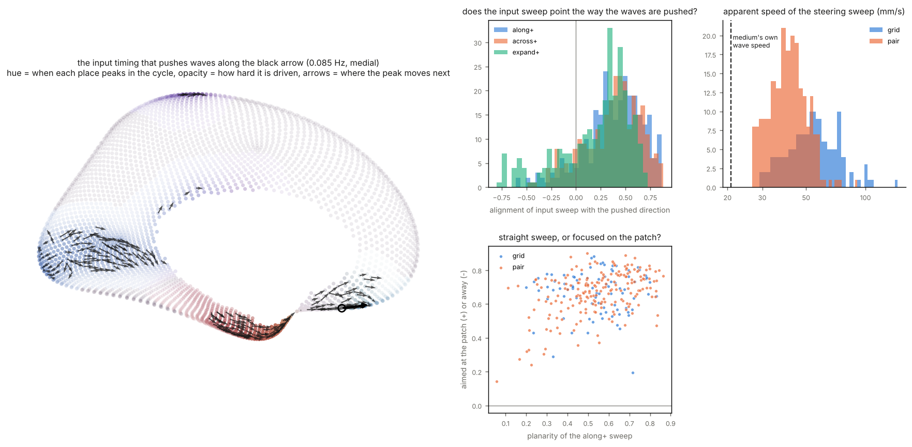
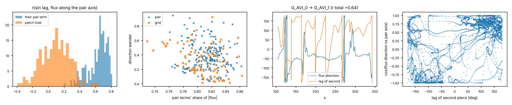
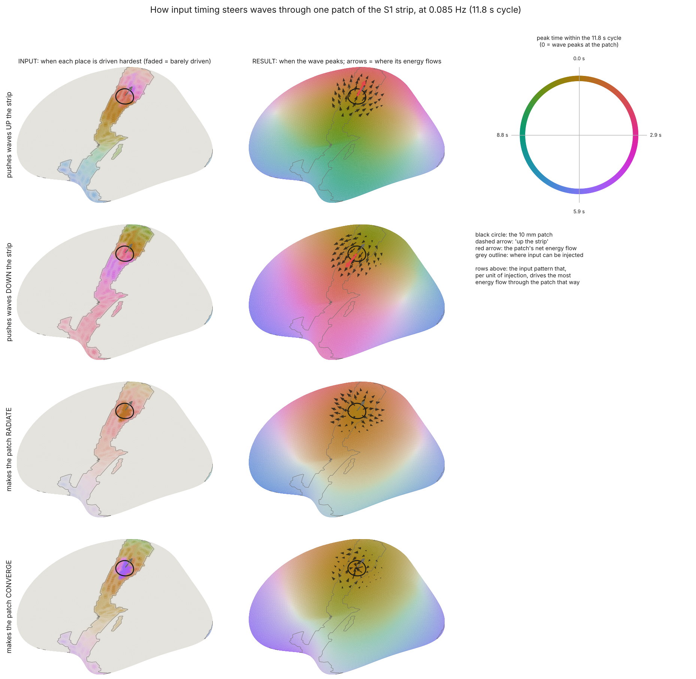
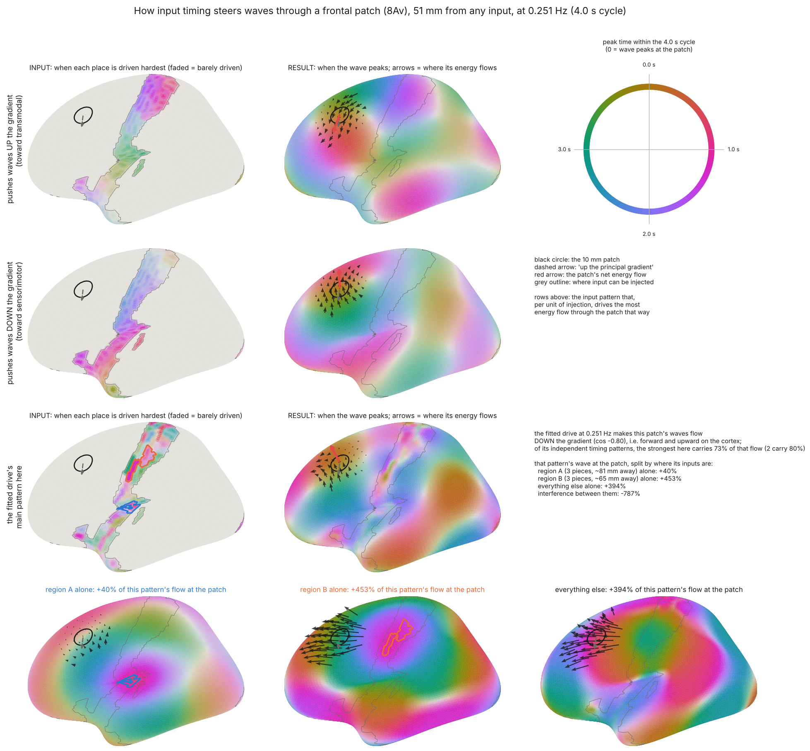
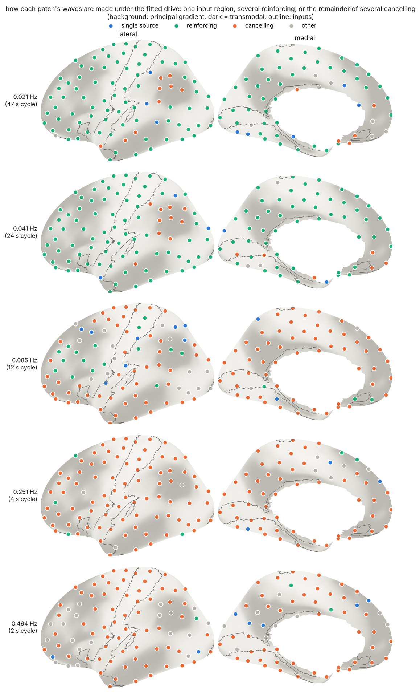
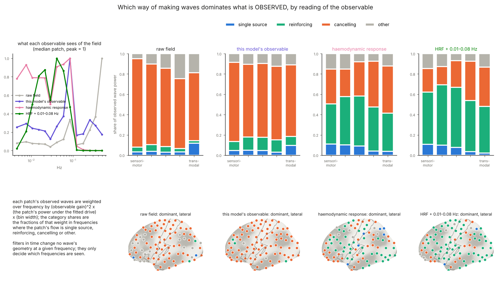
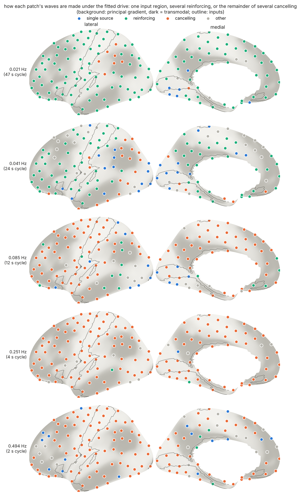
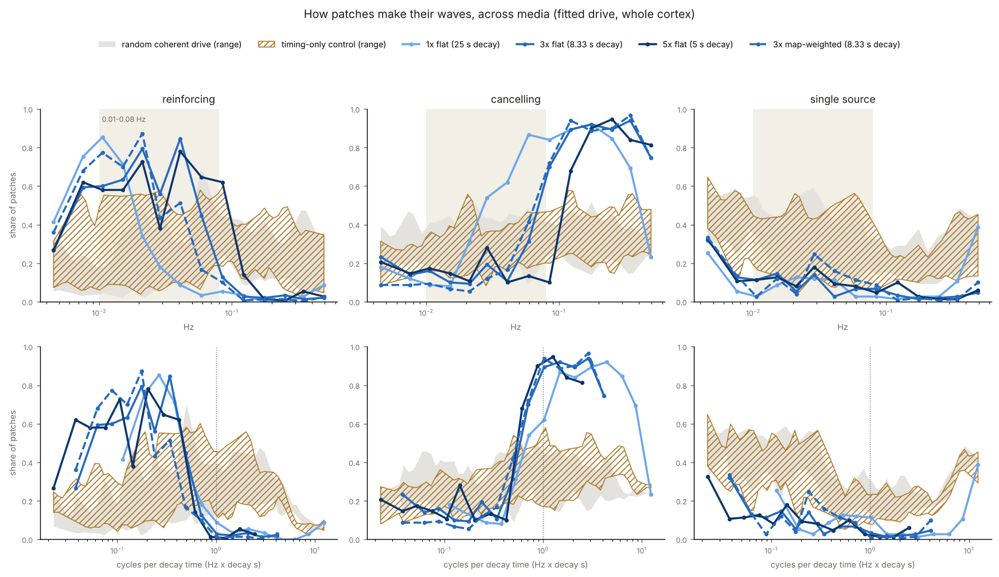

# How input timing shapes waves: findings

Working notes on how the temporal interplay between the 100 input regions gives rise to
waves of different directions and types in the fitted medium. Code: `analysis/waves.py`,
`analysis/interplay.py`, `viz/render_steering.py`. Started 2026-10, branch
`claude/sweet-ramanujan-xrccxd`.

Everything here is computed on the **actual solves**: the fitted drive cross-spectrum S(f)
and the medium it was fitted in. Nothing is refitted for the wave analysis. The principal
gradient is used only as an external map to read results against, never as an input to
the medium.

Status of the numbers: the analyses were first run in October on the box-impulse solves.
The container that held them was later reclaimed. All four solves were rebuilt on
2026-11-24 with the same flags (see [Reproducing](#reproducing)), and every analysis
quoted here was re-run on the rebuilt solves. Three October figures did not survive
the re-run, and the text now says so where each appears. They were the 94% timing-vs-loudness
figure, the R² ≈ 0.38 direction regression, and the "cosine 0.82" direction prediction. The tables give the rebuilt values. 1x,
5x and the map-weighted 3x reproduced exactly. The rebuilt flat 3x scores 0.756
against 0.757, and its category shares moved by 1–4 points. Figures are in
`docs/figures/`.

---

## 1. Models

All are unfiltered-RBC-target solves on the flat medium (except the map-weighted 3x),
100 input pieces, factored solver at rank 20, 6 mm smoothing, frames are mean over steps.

| tag | medium | speed | decay | steps / frame |
|---|---|---|---|---|
| `nobp_sm6_s1_box` | 1x flat | 1.5 mm/s | 25 s | 4 |
| `nobp_sm6_s3_box` | 3x flat | 4.5 mm/s | 8.33 s | 12 |
| `nobp_sm6_mapsmm_s3_box` | 3x, map-weighted (IQR-clipped, median-matched) | 4.5 mm/s median | 8.33 s median | 18 |
| `nobp_sm6_s5_box` | 5x flat | 7.5 mm/s | 5 s | 20 |
| (`nobp_sm6_s10_box`) | 10x flat | 15 mm/s | 2.5 s | — |

10x was dropped from the wave analysis: it sits at the limit of the mesh resolution and of
the compute, and its fitted drive is nearly rank one (effective rank 1.8).

## 2. The impulse fix, and what it did to the scores

The impulse responses the solver is built on were wrong whenever a frame spans many
integrator steps. The old code put a frame's whole drive into the field in one step. The
simulation instead spreads it as 1/save per step over the frame. At save 12 the two
disagreed: r = 0.80–0.88 at 0.01–0.085 Hz under frame-mean readout, and r = 0.22 at 3 Hz.
`xspec.impulse_series` now injects a box over the frame and reads it out as `fluid.run`
does, with frame 0 divided by save. `tests/test_impulse.py` checks that convolving a
random frame-constant drive with the responses reproduces `fluid.run` at save 12 to
r > 0.9999, for both snapshot and mean readouts.

Realised score: FC similarity over 3578 frames (577 s), mean ± sd over 4 draws.

| model | before the fix | after the fix | change |
|---|---|---|---|
| 1x | 0.717 | 0.724 | +0.007 |
| 3x flat | 0.727 | 0.757 | +0.030 |
| 3x map-weighted | 0.718 | 0.739 | +0.021 |
| 5x | 0.689 | 0.739 | +0.050 |
| 10x | 0.521 | 0.608 | +0.087 |

The gain grows with steps per frame, which is where the old impulse was most wrong. The
earlier speed curve, which put 1x on top, was penalising the fast media through an error in
the code, not through anything about the media.

### Solving longer

150 evaluations is a deliberate early stop in this repo: longer solves raise the fit but
concentrate the drive into fewer modes. The repo's iteration selector (`--select-iters`)
does not support the factored solver, so the stopping point was compared directly.

| model | evaluations | solve corr | realised score | effective rank of the simulated field |
|---|---|---|---|---|
| 5x | 150 | 0.785 | 0.739 ± 0.003 | 9.6 |
| 5x | 300 | 0.795 | 0.748 ± 0.005 | 5.8 |
| 5x | 600 | 0.802 | 0.757 ± 0.003 | 1.9 |
| 3x flat | 150 | 0.809 | 0.756 ± 0.002 | 18.6 |
| 3x flat | 600 | 0.818 | 0.764 ± 0.003 | 5.5 |

The realised score keeps rising with evaluations, but by 600 the 5x field is almost one
pattern. A one-dimensional field leaves little to analyse as interplay between regions,
so the wave analysis uses the 150-evaluation solves throughout, matched across media.

3x was then run to 600 evaluations as well, to compare the two speeds at matched effort.
It does the same thing more slowly. Its realised score rises 0.756 → 0.764 while the rank
falls 18.6 → 5.5. At both stopping points 3x scores above 5x (0.756 vs 0.739 at 150;
0.764 vs 0.757 at 600), and at 600 it keeps more structure (rank 5.5 vs 1.9). On this
evidence 3x fits at least as well as 5x, but the gap narrows with effort and the scores
are within about 0.01. That is too close to call a best speed from score alone.

---

## 3. Method

**Linear medium, one frequency at a time.** At frequency f each input piece k contributes
a fixed complex depth pattern H_k(v) and velocity pattern U_k(v) per unit drive. These
transfer functions come from box impulses run through the integrator
(`waves.transfer_fields`). `tests/test_waves.py` checks them against a directly driven run:
depth r > 0.995, flux r > 0.99.

**Readouts.** At each vertex:

- depth power |h|²;
- energy flux depth·½Re(conj(h)u), which points where the waves carry energy;
- phase gradient, for the crest direction;
- a travelling index.

Under a drive z (a vector over the inputs), flux and power are quadratic forms Re(z^H M z)
with M Hermitian. Under the fitted cross-spectrum S they split *exactly* into a term per
input (its own emission) plus a term per pair (their interference). This makes "which
inputs shape the waves" a decomposition, not a regression.

**Steering modes.** For a patch (vertices within 10 mm) and a readout (flux along an axis,
across it, or outward), the extreme eigenvectors of M are the input timing patterns that
push hardest each way. They are computed per unit drive, or per unit injected area via the
generalised problem M x = λ W x. Each mode is described by:

- sweep score: does timing advance across the inputs toward the patch;
- participation and spatial extent;
- alignment and planarity;
- aim at the patch.

**Whole-cortex categories.** 150 patches (centres 15 mm apart, radius 10 mm), with the
patch axis pointing up the principal gradient. Each patch's input regions are found from
its per-input source shares (`source_map`). The net flux is then split exactly into the
top three regions each alone, everything else, and the interference between them
(`flow_alone`). The provisional round-number thresholds are:

- **cancelling**: the parts alone push at least twice the net, so the net is a remainder;
- **reinforcing**: interference adds at least 40% of the net;
- **single source**: one region alone gives 60–150% of the net, the rest little;
- **other**: none of these.

**Reading by what BOLD sees.** Each patch's categories are weighted over 14 frequencies
(0.0045–0.49 Hz) by (observable gain)² × the patch's power under the fitted drive × bin
width. There are four *linear* readings:

- the raw field;
- this model's own scored observable (gaussian kernel, FWHM 8 frames = 1.29 s);
- the SPM canonical HRF;
- the HRF with the 0.01–0.08 Hz passband.

A linear filter reweights frequencies and changes no wave's geometry at any one of them.
A slow, strongly nonlinear transformation from field to BOLD is not represented, and is a
reasonable alternative reading. These weightings are one view, not the right one.

**Drive controls** (`--drive`):

- *independent*: S → diag S. Each input keeps its power, all coherence is removed, and
  interference is zero by construction.
- *random*: the fitted eigenvalues at every frequency with Haar-random eigenvectors.
  Coherent like the fit, with timing patterns never fitted to anything. Three seeds.

Random eigenvectors also randomise how loud each input is, not only its timing. A
timing-only control that keeps each input's fitted loudness has not been run.

---

## 4. Findings in the 3x flat medium

### Direction comes from timing sweeps across the inputs

Numbers from `interplay.py steer` (per unit drive) and `sweeps` (per unit injected area,
0.085 Hz) on the rebuilt 3x solve.

- **Timing advances toward the patch.** In the modes that push waves along or across a
  patch, downstream inputs lag upstream ones. Sweep scores are +0.81 to +0.96 at 0.06 Hz.
  They weaken as frequency rises: +0.49 to +0.84 at 0.085 Hz and +0.44 to +0.73 at 0.12 Hz.
- **The modes are long-range.** Per unit drive, a mode uses about 22–27 pieces centred
  50–61 mm from the patch. Per unit area, it spans 89–100 mm.
- **They are aimed at the patch.** The aim score is +0.64 to +0.71 (per unit area).
- **They sweep 2–3x faster than the medium's phase speed.** Phase speed is 20.8 mm/s at
  0.085 Hz, a wavelength of 246 mm. The input sweeps run at 41–65 mm/s, 2.0–3.1x that.
- **Radiating is local and easier than converging.** The radiating mode uses only 5–9
  pieces centred 25–36 mm away, and pushes about 1.8x harder per unit drive than its
  converging opposite (pair patches). Per unit area, converging modes are centred
  75–84 mm away.




### Timing predicts wave type better than loudness, but regressions predict direction poorly

`interplay.py types` on the rebuilt 3x solve: a 1154 s realisation, band 0.06–0.12 Hz,
states read every 0.97 s (about 69 independent states), with the 8 loudest inputs per patch.
Pairwise features: *timing* is the cos and sin of each pair's phase difference; *loudness*
is each input's share of the power; *both* is the cross-products, which is the form the
flux actually takes.

- **Wave type** (which of seven patterns a patch shows: along or across either way,
  radiating, converging, mixed). Blocked cross-validated balanced accuracy, median over
  patches:

  | patches | chance | timing | loudness | both | timing beats loudness in |
  |---|---|---|---|---|---|
  | grid (87) | 0.20 | 0.37 | 0.32 | 0.43 | 80% of patches |
  | pair (197) | 0.17 | 0.35 | 0.29 | 0.40 | 82% of patches |

  Timing is the better single predictor in most patches, but every model is modestly above
  chance. The October run reported 94%. That run was on the solve that was lost, and the
  figure is not reproduced here.
- **Continuous direction** (flux along, across, outward). Median cross-validated R² is
  0.04–0.09 from timing and 0.07–0.17 from loudness. The combined features have a median
  of 0: with about 64 features against about 69 independent states they overfit. So the
  regressions say little about direction either way. The October figure of R² ≈ 0.38 does not
  reproduce. The code notes a median of 0.26 → 0.46 on 40 patches when pairwise features
  replaced per-piece ones, but that was an earlier version of the analysis.
### Frame by frame, interference carries most of the flux

`interplay.py frames` on the rebuilt 3x solve uses the same 1154 s realisation and
0.06–0.12 Hz band. It splits each patch's flux at every frame exactly into own-emission and
pair terms. The split reproduces the integrated run to r = 1.000000.

| | pair patches (197) | grid patches (87) |
|---|---|---|
| pair terms' share of the flux magnitude along its direction (median) | 0.82 | 0.81 |
| cos between the total flux and own emission alone (median) | +0.16 | +0.40 |
| power from pair interference, as a share of the total (median) | −111% | −140% |
| how much the direction wanders over time (1 − mean resultant length) | 0.35 | 0.31 |

- **Interference carries the flux.** About four fifths of the flux along a patch's direction
  comes from pair terms.
- **Interference turns the flux.** Own emission alone points well away from the actual flux.
- **Interference cancels power.** The inputs' own emissions alone would give about 2.1–2.4x the
  power that is actually there.
- **One pair does not decide a patch.** In pair patches, the sine of the lag between the two
  named inputs tracks their own pair term well (r median 0.66, IQR 0.58–0.72). It tracks
  the patch's total flux only weakly (r 0.10), because the other inputs' terms dominate.

The October notes gave "mean cosine 0.82, r = 0.67" for the exact form predicting
direction. Those were these two numbers misattributed: the pair share, and the lag-vs-pair-term
correlation. No direction-prediction cosine has been measured.



### Two worked examples

`viz/render_steering.py --site s1|frontal`: input timing beside the wave it makes.

Both are per unit injected area, for the rebuilt 3x solve.

- **S1-strip patch.** Separate timing patterns push waves up or down the strip, or make the
  patch radiate or converge. Radiating uses the nearest inputs (44–58 mm rms away over
  0.085–0.49 Hz). Pushing down the strip needs inputs 67–81 mm away, converging 77–82 mm,
  and pushing up the strip 91–97 mm.
- **Frontal patch 8Av** (51 mm from the nearest input). The figures below split the strongest
  timing pattern at the patch, which carries 73–78% of the fitted flow.
  - At 0.085 Hz one remote region (11 pieces, about 73 mm away) gives +99% of the flow.
  - At 0.25 Hz the flow is the remainder of strong cancellation. One region alone gives
    +453% of the net and everything outside the two named regions gives +394%. Their
    interference is −787%.
  - At 0.49 Hz the same pattern holds: +282% (one region), +8% (a second region), +78%
    (the rest), and −269% interference.




### Across the whole cortex: reinforcing when slow, cancelling when fast

Share of the 150 patches by category, fitted drive:

| Hz | single source | reinforcing | cancelling | other |
|---|---|---|---|---|
| 0.021 | 5% | 79% | 9% | 6% |
| 0.041 | 3% | 85% | 11% | 2% |
| 0.085 | 7% | 13% | 70% | 11% |
| 0.25 | 2% | 3% | 89% | 5% |
| 0.49 | 5% | 2% | 75% | 19% |



Green: reinforcing. Orange: cancelling. Blue: single source. Grey: other. The background
is the principal gradient (dark = transmodal). Against the gradient:
[figures/interplay_combine_nobp_sm6_s3_box_gradient.png](figures/interplay_combine_nobp_sm6_s3_box_gradient.png).

- **Single-source patches are rare** at every frequency (2–7%). Almost every patch's waves
  come from several input regions, usually remote.
- **The gradient matters only at slow frequencies.** There, cancelling patches are more
  common at the transmodal end. At fast frequencies the categories do not separate along
  the gradient.

### What BOLD would see

Share of each patch's observed wave power by category, all patches. The last column is
cancelling in the sensorimotor and transmodal fifths of the gradient.

| reading | single | reinforcing | cancelling | other | cancelling, SM / TM |
|---|---|---|---|---|---|
| raw field | 5% | 5% | 76% | 15% | 87% / 67% |
| this model's observable | 5% | 11% | 73% | 10% | 78% / 71% |
| HRF | 8% | 43% | 37% | 12% | 34% / 46% |
| HRF + 0.01–0.08 Hz | 7% | 53% | 29% | 11% | 23% / 39% |



The model's own observable sits close to the raw field, at 73% cancelling. Weighting
by the HRF moves the picture from mostly cancelling to roughly half reinforcing, because
the HRF passes the slow bins where inputs reinforce.

### Which of this the fitted drive is responsible for

Share by category, raw field, all patches:

| drive | single source | reinforcing | cancelling |
|---|---|---|---|
| fitted | 5% | 5% | 76% |
| independent inputs | 50% | 0% | 20% |
| random coherent (3 seeds) | 19–24% | 31–41% | 16–31% |

- **Specific to the fit:**
  - fast cancellation;
  - the rarity of single-source patches. Independent inputs give 50–57% single source
    across the readings, random coherent drive 18–31%.
- **Not clearly specific:** the slow reinforcing picture. Random coherent drive is already
  19–49% reinforcing, depending on seed and reading.
- **Looked fit-specific in the flat medium:** more cancellation transmodally than in
  sensorimotor cortex under the HRF. It does not survive a change of medium (next section).

---

## 5. Other media

### Map-weighted 3x: the same picture, except the gradient asymmetry

Same 150 patches as the flat 3x. Shares are single source / reinforcing / cancelling / other.

| Hz | flat 3x | map-weighted 3x | same category | direction agreement (r) |
|---|---|---|---|---|
| 0.021 | 5 / 79 / 9 / 6 | 4 / 87 / 5 / 3 | 79% | +0.78 |
| 0.041 | 3 / 85 / 11 / 2 | 16 / 51 / 17 / 16 | 54% | +0.78 |
| 0.085 | 7 / 13 / 70 / 11 | 9 / 10 / 72 / 9 | 61% | +0.76 |
| 0.25 | 2 / 3 / 89 / 5 | 1 / 1 / 90 / 8 | 81% | +0.41 |
| 0.49 | 5 / 2 / 75 / 19 | 10 / 3 / 75 / 13 | 61% | +0.50 |



The controls are qualitatively the same:

| drive | single source | cancelling |
|---|---|---|
| fitted | 9% | 74% |
| independent inputs | 52–65% | |
| random coherent | 20–31% | 19–39% |

The frontal patch 8Av reads the same way:

- at 0.085 Hz one remote region gives 101% of the flow;
- at 0.49 Hz two regions alone give +276% and +53%, everything else +128%, with
  interference −357%.

What does **not** carry over is the gradient asymmetry under the HRF. Cancelling in the
sensorimotor / transmodal fifths:

| reading | flat 3x | map-weighted 3x |
|---|---|---|
| raw field | 87 / 67% | 88 / 66% |
| HRF | 34 / 46% | 29 / 30% |
| HRF + 0.01–0.08 Hz | 23 / 39% | 23 / 24% |

So the transmodal excess depends on the medium as well as the fit.

### Speed series: the switch sits at half a cycle per decay

Measured in Hz, the change from reinforcing to cancelling spreads over a factor of five
across media. Measured in **cycles per decay time** (Hz × decay s), the media line up:

| medium | decay | reinforcing gives way to cancelling at | cycles per decay |
|---|---|---|---|
| 1x | 25 s | 0.022 Hz | 0.54 |
| 3x flat | 8.33 s | 0.063 Hz | 0.53 |
| 5x | 5 s | 0.102 Hz | 0.51 |
| 3x map-weighted | 8.33 s (median) | 0.051 Hz | 0.42 |



Top row in Hz (shaded: 0.01–0.08 Hz), bottom row in cycles per decay time (dotted: one
cycle). The grey band is the range of the random coherent drive over all media and seeds.

The crossover is where the reinforcing and cancelling shares are equal, interpolated in
log frequency (`interplay.py media`).

The random coherent drive shows no switch. It stays at roughly 10–35% reinforcing and
20–40% cancelling at every frequency, in every medium. So:

- the medium's decay time sets *where* the switch is;
- the fitted drive supplies the strong contrast either side of it.

Below about half a cycle per decay, the fitted inputs add up. Above it, the waves at most
patches are what is left after the inputs largely cancel.

Other features of the slower and faster media:

- **1x, fastest bin (0.49 Hz, 12 cycles per decay):** 39% single source. At this slow speed
  each patch is reached mainly by nearby inputs.
- **1x, direction:** agreement with 3x per patch is lower (r = 0.24–0.49) than between the
  two 3x media (0.41–0.78).

### Consequence: what BOLD sees depends on the medium's decay

| reading | 1x | 3x flat | 5x |
|---|---|---|---|
| raw field | 24 / 7 / 47 / 22 | 5 / 5 / 76 / 15 | 6 / 8 / 75 / 12 |
| this model's observable | 10 / 7 / 68 / 14 | 5 / 11 / 73 / 10 | 6 / 26 / 55 / 13 |
| HRF | 9 / 16 / 59 / 16 | 8 / 43 / 37 / 12 | 10 / 60 / 17 / 13 |
| HRF + 0.01–0.08 Hz | 10 / 17 / 55 / 18 | 7 / 53 / 29 / 11 | 10 / 64 / 14 / 12 |

(single source / reinforcing / cancelling / other, %, all patches)

The 0.01–0.08 Hz band lies mostly *below* the switch in 3x and 5x, but mostly *above* it in
1x. So under the HRF:

- the BOLD-visible waves are mostly reinforcing in 3x and 5x;
- they are mostly cancelling in 1x.

Fit alone does not decide between the media: 1x scores 0.724, 3x 0.756 and 5x 0.739.

---

## 6. Caveats and open questions

- **The category thresholds are provisional round numbers.** The 2x overshoot for
  cancelling, 40% interference for reinforcing, and 60–150% for single source were not
  tuned. The crossover frequency is read where two shares are equal, and is less sensitive
  to them.
- **The map weightings are somewhat arbitrary.** Only one map-weighted medium was analysed.
- **BOLD is represented only by linear readings.** A slow, nonlinear transformation may lose
  information in ways none of these capture.
- **Regressions on long realisations are sample-limited.** About 69 independent states in
  the 0.06–0.12 Hz band over 1154 s is too few for 64 pairwise features. A longer
  realisation, or fewer inputs per patch, would be needed before reading anything into the
  timing-vs-loudness R².
- **Only three random-control seeds were run**, and the random control changes loudness as
  well as timing.
- **Media were compared at 150 evaluations.** Longer solves concentrate the drive, and
  whether the half-cycle-per-decay switch holds in a more converged solve is untested.
- **Why half a cycle per decay?** Not yet explained. A first guess: below it, the medium's
  response at a patch keeps a similar phase over the distances that separate input regions,
  so coherent inputs add. The obvious test is a medium-only calculation of that phase
  spread against distance.

---

## Reproducing

```bash
bash fetch_remote_data.sh                      # data bundle + shared models
pip install numpy scipy scikit-learn matplotlib nibabel cmocean trimesh pytest

COMMON="--oversample 4 --impulse-decays 7 --pad 4096 --nfreq 192 --bold-smooth \
  --regions hybrid --split 50 --nvert 2000 --val-vert 0 --solver factor --rank 20 \
  --seconds 577 --draws 4 --workers 3 --hybrid-file results/xspec_asc_first_area_100.npz \
  --fc-path results/fc/nobp/group-RBCNKI100nobp_hemi-L_space-fsaverage5_mask-glasser_spearmanfc.npy \
  --smooth-fwhm 6 --decimate mean --maxfun 150"
python fit/best_fit.py $COMMON --maps-scale 0 --decay-s 8.3333 --spread-mm-s 4.5 --tag nobp_sm6_s3_box
python fit/best_fit.py $COMMON --maps-scale 0 --decay-s 25 --spread-mm-s 1.5 --tag nobp_sm6_s1_box
python fit/best_fit.py $COMMON --maps-scale 0 --decay-s 5 --spread-mm-s 7.5 --tag nobp_sm6_s5_box
python fit/best_fit.py $COMMON --maps-scale 1 --map-clip iqr --maps-median-match \
  --decay-s 8.3333 --spread-mm-s 4.5 --tag nobp_sm6_mapsmm_s3_box

# per medium (TAG as above)
python analysis/interplay.py bold --tag $TAG                       # 14 bins, 4 readings
python analysis/interplay.py combine --tag $TAG                    # 5 bins, maps
python analysis/interplay.py bold --tag $TAG --drive independent
python analysis/interplay.py bold --tag $TAG --drive random --seed 0   # and 1, 2
python viz/render_steering.py --tag $TAG --site s1 --hz 0.0848     # or --site frontal, other --hz

python analysis/interplay.py media                                 # across media
```

The earlier 3x analyses (`pairs`, `frames`, `types`, `steer`, `sweeps`, `remote`) take
`--tag nobp_sm6_s3_box` the same way. `frames` and `types` cache several GB of responses.
